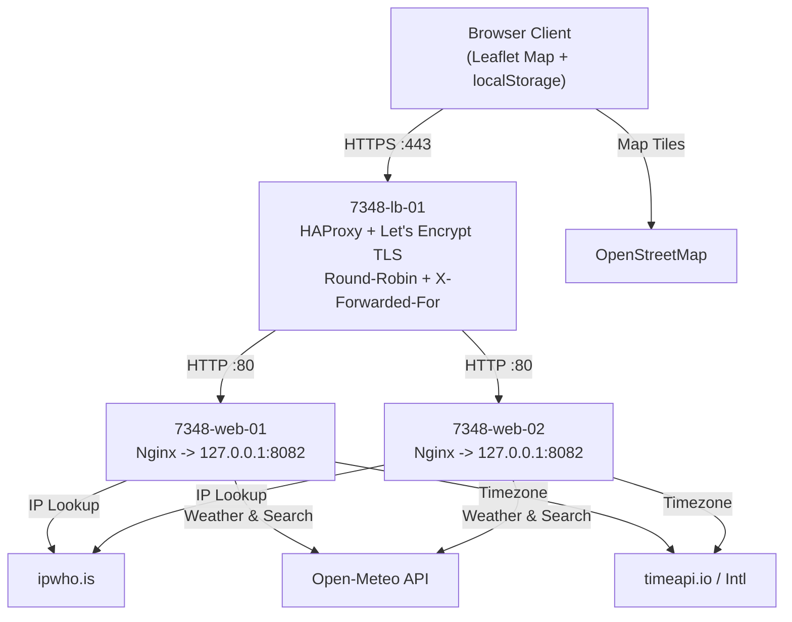
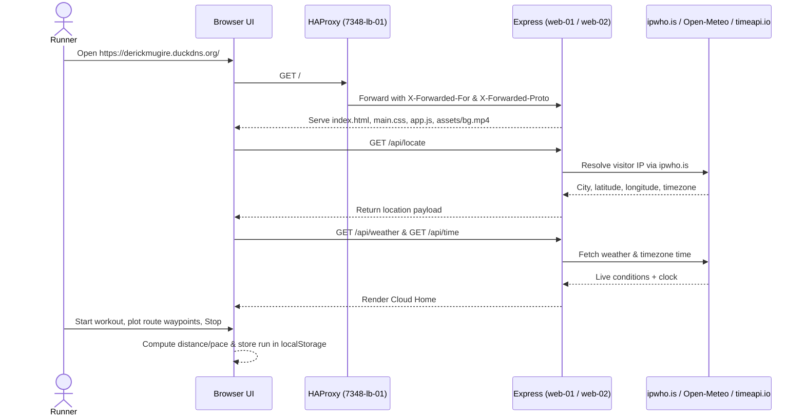

# StrideMate

A minimal, monochrome weather, local clock, and workout route-mapping web app built with Node.js, Express, vanilla JavaScript, and Leaflet + OpenStreetMap.

- **Live App:** https://derickmugire.duckdns.org/
- **Source:** https://github.com/DerrickMugire/Stride

---

## Screens & Workflow

StrideMate intentionally avoids accounts, feeds, and clutter, splitting the experience into two focused views and a slide-over history panel:

1. **Cloud Home (`/`)**
   - Displays your detected city, live weather (click the temperature to switch between `°C` and `°F`), and a live ticking local clock inside a frosted-glass cloud card over a looping background video (`frontend/assets/bg.mp4`).
   - Top-right menu (`≡`) opens **Saved Runs**; **START WORKOUT** launches the map.
2. **Workout Map**
   - Full-bleed dark OpenStreetMap view (`is-dark-map` CSS filter) centered on your `ME` marker.
   - Click anywhere on the map to plot waypoints and calculate live Haversine distance (`km`), elapsed `TIME` (`HH:MM:SS`), and live pace (`min/km`).
   - Controls: **Back**, **Search location...** autocomplete, **Undo** last waypoint, **Activity** (`Run` / `Walk` / `Cycle`), **Pause** / **Resume**, and **Stop**.
3. **Saved Runs Drawer**
   - Persists completed sessions in browser `localStorage` (`stridemate_saved_runs`) with live search, activity filter (`All` / `Run` / `Walk` / `Cycle`), sorting (`Newest` / `Longest Time` / `Longest Distance`), and **Delete**.

> **Location Note:** Initial city detection uses your IP via `/api/locate`. When you start a workout, your browser may prompt for GPS permission (`navigator.geolocation`) to center the `ME` marker more accurately; you can also jump to any city manually using **Search location...**.

---

## Architecture & Request Flow





---

## Data & Privacy

StrideMate runs with **no database and no server-side user storage**:

- **Browser (`localStorage`):** Saved workout logs (`activity`, `location`, `durationSec`, `distanceKm`, `pace`, `createdAt`) stay on your device under `stridemate_saved_runs` until you delete them.
- **Backend (`Express`):** Acts strictly as a stateless proxy for external APIs and static frontend files.
- **Network hardening:** Express binds to `127.0.0.1:8082` behind Nginx on port `80` (port `8082` is never exposed), and `7348-lb-01` enforces HTTPS (`:80` -> `:443` `301` redirect).

---

## Quick Start (Local)

Requires **Node.js 18+** (built-in `fetch`) and **npm**.

```bash
git clone https://github.com/DerrickMugire/Stride.git
cd Stride/backend
npm install
npm start
```

Open `http://127.0.0.1:8082` in your browser. No API keys are needed.

| Environment Variable | Purpose | Default |
| :--- | :--- | :--- |
| `PORT` | HTTP port Express listens on | `8082` |
| `HOST` | Network bind address | `127.0.0.1` |

---

## REST API Reference

| Method | Endpoint | Purpose |
| :--- | :--- | :--- |
| `GET` | `/` | Serves `frontend/index.html` |
| `GET` | `/api/health` | Health check (`{"ok":true,"service":"stridemate","port":8082}`) |
| `GET` | `/api/locate` | IP-based city, coordinates, and timezone lookup |
| `GET` | `/api/cities?q=...` | City search autocomplete (minimum 2 characters) |
| `GET` | `/api/weather?lat=...&lon=...` | Current temperature, WMO condition label, and wind speed |
| `GET` | `/api/time?zone=...` | Current local time for an IANA timezone |

All upstream requests enforce a 6-second timeout (`AbortSignal.timeout(6000)`). Invalid coordinates or timezone names return `400`, upstream errors return `502`, and `/api/time` falls back to Node's `Intl.DateTimeFormat` if `timeapi.io` is unreachable.

---

## Repository Layout

```text
Stride/
├── backend/
│   ├── package.json         # Express dependency and start script
│   └── server.js            # Static file server and /api/* proxy endpoints
├── frontend/
│   ├── assets/
│   │   └── bg.mp4           # Looping Cloud Home background video
│   ├── scripts/
│   │   └── app.js           # Weather/clock state, Leaflet map, timer, Saved Runs
│   ├── styles/
│   │   └── main.css         # Monochrome styling, dark map filter, drawer layout
│   └── index.html           # App shell for Cloud Home, Map, and Saved Runs
├── .gitignore
└── README.md
```

---

## External APIs & Attribution

| Service | Usage | Link |
| :--- | :--- | :--- |
| **Open-Meteo** | Weather forecast (`GET /api/weather`) and city geocoding (`GET /api/cities`) | [open-meteo.com](https://open-meteo.com/) |
| **ipwho.is** | Visitor IP geolocation (`GET /api/locate`) | [ipwho.is](https://ipwho.is/) |
| **timeapi.io** | Timezone time sync (`GET /api/time`) | [timeapi.io](https://timeapi.io/) |
| **OpenStreetMap & Leaflet** | Map tiles and interactive route rendering | [openstreetmap.org](https://www.openstreetmap.org/) / [leafletjs.com](https://leafletjs.com/) |

---

## Infrastructure & Deployment (`7348-*`)

Deployed across three Ubuntu 20.04 nodes:

- **`7348-web-01` (`35.178.14.237`) & `7348-web-02` (`18.130.237.6`):**
  - Run `node /opt/stridemate/backend/server.js` under `systemd` (`stridemate.service`) bound to `127.0.0.1:8082`.
  - Nginx listens on `:80`, proxies to `http://127.0.0.1:8082`, and sets `X-Served-By $hostname`.
- **`7348-lb-01` (`18.132.9.132`):**
  - HAProxy balances traffic in `roundrobin` mode across both web nodes with `option httpchk GET /api/health` and `option forwardfor`.
  - Terminates Let's Encrypt TLS on `:443` for `derickmugire.duckdns.org` and redirects `:80` to `:443`.

```bash
# Verify round-robin load balancing and TLS
curl -sI https://derickmugire.duckdns.org/api/health | grep -iE "HTTP/|x-served-by"
curl -sI https://derickmugire.duckdns.org/api/health | grep -iE "HTTP/|x-served-by"

# Verify live API responses
curl -s https://derickmugire.duckdns.org/api/locate
curl -s "https://derickmugire.duckdns.org/api/weather?lat=-1.95&lon=30.06"
```

---

## Engineering Notes & Trade-offs

- **Forwarding real visitor IPs behind HAProxy:** Because the AWS nodes sit in `eu-west-2` (London), `/api/locate` initially saw the load balancer's IP rather than the user's IP. Enabling `option forwardfor` in HAProxy passes `X-Forwarded-For` cleanly to Express.
- **HTTPS without a custom TLD:** Using DuckDNS (`derickmugire.duckdns.org`) with Certbot + HAProxy TLS termination provides valid HTTPS and automatic `:80 -> :443` redirection without needing a paid domain.
- **Click-to-plot vs. continuous GPS:** Route waypoints are plotted by clicking on the map so workouts can be planned or tested reliably on both desktop and mobile without requiring continuous background GPS permissions.
