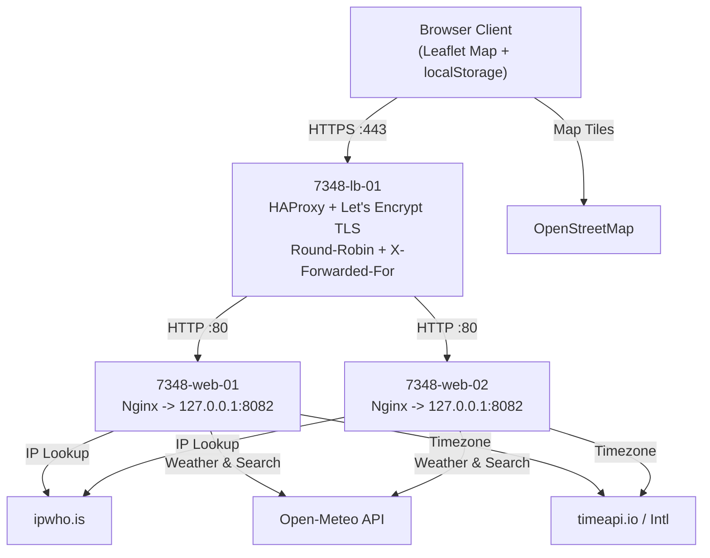
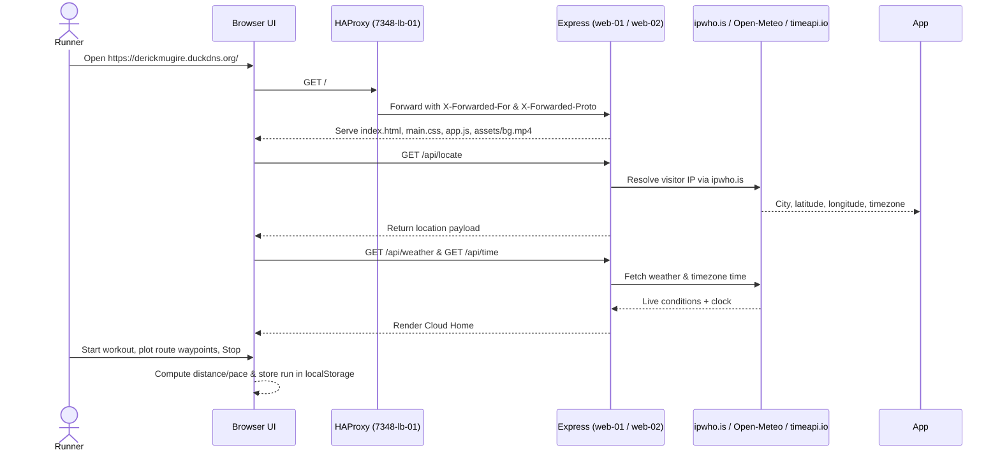

# StrideMate

A minimal, monochrome weather, local clock, and workout route-mapping web app built with Node.js, Express, vanilla JavaScript, and Leaflet + OpenStreetMap.

- **Live App:** https://derickmugire.duckdns.org/
- **Repository:** https://github.com/DerrickMugire/Stride

---

## Screens & Workflow

StrideMate splits the experience into two focused views and a slide-over history panel:

1. **Cloud Home (`/`)**
   - Displays your detected city, live weather (click the temperature to toggle `°C` / `°F`), and a live local clock inside a frosted-glass cloud card over a looping background video (`frontend/assets/bg.mp4`).
   - Top-right menu (`≡`) opens **Saved Runs**; **START WORKOUT** launches the map.
2. **Workout Map**
   - Full-bleed dark OpenStreetMap view centered on your `ME` marker.
   - Click anywhere on the map to plot waypoints and calculate live Haversine distance (`km`), elapsed `TIME` (`HH:MM:SS`), and live pace (`min/km`).
   - Controls: **Back**, **Search location...** autocomplete, **Undo** last waypoint, **Activity** (`Run` / `Walk` / `Cycle`), **Pause** / **Resume**, and **Stop**.
3. **Saved Runs Drawer**
   - Persists completed sessions in browser `localStorage` (`stridemate_saved_runs`) with live search, activity filter (`All` / `Run` / `Walk` / `Cycle`), sorting (`Newest` / `Longest Time` / `Longest Distance`), and **Delete**.

> **Location Note:** Initial city detection uses your IP via `/api/locate`. When you start a workout, your browser may prompt for GPS permission (`navigator.geolocation`) to center the `ME` marker more accurately; you can also jump to any city manually using **Search location...**.

---

## Architecture & Request Flow





---

## Quick Start (Local)

**Prerequisites:** **Node.js 18+** (for built-in `fetch`) and **npm**.

```bash
git clone https://github.com/DerrickMugire/Stride.git
cd Stride/backend
npm install
npm start
```

Open `http://127.0.0.1:8082` in your browser. No API keys are required.

| Environment Variable | Purpose | Default |
| :--- | :--- | :--- |
| `PORT` | HTTP port Express listens on | `8082` |
| `HOST` | Network bind address | `127.0.0.1` |

---

## REST API Reference

| Method | Endpoint | Purpose |
| :--- | :--- | :--- |
| `GET` | `/` | Serves `frontend/index.html` |
| `GET` | `/api/health` | Health check (`{"ok":true,"service":"stridemate","port":8082}`) |
| `GET` | `/api/locate` | IP-based city, coordinates, and timezone lookup |
| `GET` | `/api/cities?q=...` | City search autocomplete (minimum 2 characters) |
| `GET` | `/api/weather?lat=...&lon=...` | Current temperature, WMO condition label, and wind speed |
| `GET` | `/api/time?zone=...` | Current local time for an IANA timezone |

All upstream requests enforce a 6-second timeout (`AbortSignal.timeout(6000)`). Invalid coordinates or timezone names return `400`, upstream errors return `502`, and `/api/time` falls back to Node's `Intl.DateTimeFormat` if `timeapi.io` is unreachable.

---

## Repository Layout

```text
Stride/
├── backend/
│   ├── package.json         # Express dependency and start script
│   └── server.js            # Static file server and /api/* proxy endpoints
├── frontend/
│   ├── assets/
│   │   └── bg.mp4           # Looping Cloud Home background video
│   ├── scripts/
│   │   └── app.js           # Weather/clock state, Leaflet map, timer, Saved Runs
│   ├── styles/
│   │   └── main.css         # Monochrome styling, dark map filter, drawer layout
│   └── index.html           # App shell for Cloud Home, Map, and Saved Runs
├── .gitignore
└── README.md
```

---

## Deployment to Web Servers (`7348-*`)

StrideMate is deployed across three Ubuntu 20.04 servers:

- **`7348-web-01` (`35.178.14.237`)** — Nginx (`:80`) -> Express (`127.0.0.1:8082`)
- **`7348-web-02` (`18.130.237.6`)** — Nginx (`:80`) -> Express (`127.0.0.1:8082`)
- **`7348-lb-01` (`18.132.9.132`)** — HAProxy (`:80` -> `:443` Let's Encrypt TLS, `roundrobin`, `option forwardfor`)

### Step 1: Set up both web servers (`7348-web-01` & `7348-web-02`)

1. **Install Node.js 20 LTS and Nginx, clone the repo, and install dependencies:**
   ```bash
   sudo apt update && sudo apt install -y git curl ca-certificates nginx
   curl -fsSL https://deb.nodesource.com/setup_20.x | sudo -E bash -
   sudo apt install -y nodejs
   sudo git clone https://github.com/DerrickMugire/Stride.git /opt/stridemate
   cd /opt/stridemate/backend && npm install --omit=dev
   ```

2. **Create the `systemd` service (`/etc/systemd/system/stridemate.service`):**
   ```ini
   [Unit]
   Description=StrideMate Node.js Server
   After=network.target

   [Service]
   Type=simple
   User=ubuntu
   WorkingDirectory=/opt/stridemate/backend
   Environment=PORT=8082
   Environment=HOST=127.0.0.1
   ExecStart=/usr/bin/node /opt/stridemate/backend/server.js
   Restart=always
   RestartSec=3

   [Install]
   WantedBy=multi-user.target
   ```
   ```bash
   sudo systemctl daemon-reload
   sudo systemctl enable --now stridemate
   ```

3. **Configure Nginx (`/etc/nginx/sites-available/stridemate`):**
   ```nginx
   server {
       listen 80 default_server;
       listen [::]:80 default_server;
       server_name _;

       add_header X-Served-By $hostname always;

       location / {
           proxy_pass http://127.0.0.1:8082;
           proxy_http_version 1.1;
           proxy_set_header Host $host;
           proxy_set_header X-Real-IP $remote_addr;
           proxy_set_header X-Forwarded-For $proxy_add_x_forwarded_for;
           proxy_set_header X-Forwarded-Proto $scheme;
       }
   }
   ```
   ```bash
   sudo rm -f /etc/nginx/sites-enabled/default
   sudo ln -sf /etc/nginx/sites-available/stridemate /etc/nginx/sites-enabled/stridemate
   sudo nginx -t && sudo systemctl reload nginx
   ```

### Step 2: Set up the load balancer (`7348-lb-01`)

1. **Install HAProxy and Certbot, then issue a Let's Encrypt certificate:**
   ```bash
   sudo apt update && sudo apt install -y haproxy certbot
   sudo systemctl stop haproxy
   sudo certbot certonly --standalone -d derickmugire.duckdns.org --non-interactive --agree-tos -m d.mugire1@alustudent.com
   sudo mkdir -p /etc/haproxy/certs
   sudo sh -c 'cat /etc/letsencrypt/live/derickmugire.duckdns.org/fullchain.pem /etc/letsencrypt/live/derickmugire.duckdns.org/privkey.pem > /etc/haproxy/certs/derickmugire.duckdns.org.pem'
   sudo chmod 600 /etc/haproxy/certs/derickmugire.duckdns.org.pem
   ```

2. **Configure `/etc/haproxy/haproxy.cfg`:**
   ```haproxy
   defaults
       log     global
       mode    http
       option  httplog
       option  dontlognull
       option  forwardfor
       timeout connect 5s
       timeout client  50s
       timeout server  50s

   frontend http_front
       bind *:80
       redirect scheme https code 301 if !{ ssl_fc }

   frontend https_front
       bind *:443 ssl crt /etc/haproxy/certs/derickmugire.duckdns.org.pem
       http-request set-header X-Forwarded-Proto https
       default_backend stridemate_web

   backend stridemate_web
       balance roundrobin
       option httpchk GET /api/health
       http-check expect status 200
       server 7348-web-01 35.178.14.237:80 check
       server 7348-web-02 18.130.237.6:80 check
   ```
   ```bash
   sudo haproxy -c -f /etc/haproxy/haproxy.cfg && sudo systemctl start haproxy
   ```

3. **Verify round-robin balancing and live API responses:**
   ```bash
   curl -sI https://derickmugire.duckdns.org/api/health | grep -iE "HTTP/|x-served-by"
   curl -sI https://derickmugire.duckdns.org/api/health | grep -iE "HTTP/|x-served-by"
   curl -s https://derickmugire.duckdns.org/api/locate
   curl -s "https://derickmugire.duckdns.org/api/weather?lat=-1.95&lon=30.06"
   ```

---

## Challenges & Solutions

- **Load balancer masking visitor IP for geolocation:** Because `7348-lb-01` is hosted in AWS `eu-west-2` (London), `/api/locate` initially received the load balancer's London IP instead of the visitor's real IP. Enabling `option forwardfor` in HAProxy forwards `X-Forwarded-For` through Nginx to Express so `ipwho.is` resolves the visitor's actual city.
- **Providing HTTPS without a custom domain:** Let's Encrypt requires a hostname rather than a raw IP. Pointing a DuckDNS subdomain (`derickmugire.duckdns.org`) to `18.132.9.132` allowed Certbot to issue a valid certificate and HAProxy to enforce `:80 -> :443` HTTPS redirection.
- **Keeping backend port `8082` unexposed:** Express binds strictly to `127.0.0.1:8082` behind Nginx on port `80` on both web nodes, ensuring port `8082` is never accessible from the public internet.
- **Dark map styling without paid tile APIs:** Instead of relying on third-party dark tile providers that require tokens or break under strict rate limits, StrideMate applies a CSS invert/hue-rotate filter (`.workout-map.is-dark-map .leaflet-tile-pane`) directly over standard OpenStreetMap tiles.

---

## APIs, Libraries & Credits

| Resource | Role in StrideMate | Official Documentation |
| :--- | :--- | :--- |
| **Open-Meteo Forecast API** | Live weather conditions & temperature (`GET /api/weather`) | [open-meteo.com/en/docs](https://open-meteo.com/en/docs) |
| **Open-Meteo Geocoding API** | City search autocomplete (`GET /api/cities`) | [open-meteo.com/en/docs/geocoding-api](https://open-meteo.com/en/docs/geocoding-api) |
| **ipwho.is** | Visitor IP geolocation (`GET /api/locate`) | [ipwho.is/documentation](https://ipwho.is/documentation) |
| **timeapi.io** | IANA timezone clock sync (`GET /api/time`) | [timeapi.io/swagger/index.html](https://timeapi.io/swagger/index.html) |
| **OpenStreetMap** | Map tiles and geographic data | [openstreetmap.org](https://www.openstreetmap.org/copyright) |
| **Leaflet.js** | Interactive map rendering, markers, and polylines | [leafletjs.com/reference.html](https://leafletjs.com/reference.html) |
| **Express.js** | Node.js HTTP server and `/api/*` routing | [expressjs.com](https://expressjs.com/) |
| **Nginx & HAProxy** | Reverse proxy and round-robin load balancing | [nginx.org](https://nginx.org/en/docs/) / [haproxy.org](https://www.haproxy.org/) |
| **DuckDNS & Let's Encrypt** | Free dynamic DNS and TLS certificates | [duckdns.org](https://www.duckdns.org/) / [letsencrypt.org](https://letsencrypt.org/docs/) |
| **Pexels** | Royalty-free looping background video (`frontend/assets/bg.mp4`) | [pexels.com/videos](https://www.pexels.com/videos/) |
