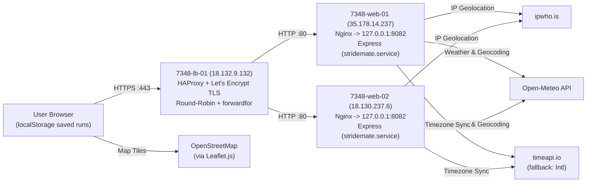

# StrideMate

StrideMate is a monochrome weather, live time, and workout route-mapping web application built with Node.js, Express, vanilla HTML/CSS/JavaScript, and Leaflet + OpenStreetMap.

**Live URL:** https://derickmugire.duckdns.org/  
**Repository:** https://github.com/DerrickMugire/Stride

---

## Interface Overview

```text
+-----------------------------------------------------------------------+
|  Cloud Home (/)                                                [ === ]|
|                                                                       |
|                         .---.                                         |
|                     .--(     )--.                                     |
|                    (  19°C · Clear )   <- click °C / °F               |
|                     (  Kigali, RW  )                                  |
|                      `-( 22:15:08 )-'                                 |
|                                                                       |
|                       [ START WORKOUT ]                               |
+-----------------------------------------------------------------------+
|  Workout Map (/map view)                                              |
|  [ Back ] [ Search location... ] [ Undo ]                             |
|                                                                       |
|             * (ME) ---- route polyline ---- *                         |
|                                                                       |
|                                        +---------------------------+  |
|                                        | TIME  00:12:40   1.85 km  |  |
|                                        | PACE  06:50 /km           |  |
|                                        | [Run v] [Pause] [ Stop ]  |  |
|                                        +---------------------------+  |
+-----------------------------------------------------------------------+
```

- **Cloud Home:** Shows your detected city, live weather (click temperature to toggle `°C` / `°F`), and a live local clock inside a frosted-glass cloud card over a looping background video (`frontend/assets/bg.mp4`).
- **Workout Map:** Full-bleed dark OpenStreetMap view via Leaflet centered on the `ME` marker. Click anywhere on the map to trace a route polyline and track live Haversine distance (`km`), elapsed `TIME` (`HH:MM:SS`), and live pace (`min/km`). Includes `Undo` waypoint, `Pause` / `Resume`, `Stop`, activity selector (`Run` / `Walk` / `Cycle`), and city search autocomplete.
- **Saved Runs Drawer:** Stores completed workouts in browser `localStorage` (`stridemate_saved_runs`) with search, activity filter (`All` / `Run` / `Walk` / `Cycle`), sorting (`Newest` / `Longest Time` / `Longest Distance`), and delete.

---

## System Architecture



---

## Project Structure

```text
stridemate/
├── backend/
│   ├── package.json
│   └── server.js
├── frontend/
│   ├── assets/
│   │   └── bg.mp4
│   ├── scripts/
│   │   └── app.js
│   ├── styles/
│   │   └── main.css
│   └── index.html
├── .gitignore
└── README.md
```

---

## Backend API & Reliability

| Endpoint | Purpose | Upstream Source |
| :--- | :--- | :--- |
| `GET /api/health` | Health check for HAProxy | Express (`200 OK`) |
| `GET /api/locate` | Detects visitor city, coordinates, and timezone from client IP | `ipwho.is` |
| `GET /api/cities?q=...` | Autocomplete city search (minimum 2 characters) | Open-Meteo Geocoding |
| `GET /api/weather?lat=...&lon=...` | Current temperature, WMO condition, and wind speed | Open-Meteo Forecast |
| `GET /api/time?zone=...` | Current local time for an IANA timezone | `timeapi.io` (`Intl` fallback) |

- **Timeouts & Validation:** Every upstream request uses a 6-second timeout (`AbortSignal.timeout(6000)`), and `/api/weather` and `/api/time` validate coordinates and IANA timezones before querying upstream APIs (`400` on invalid input, `502` on upstream failure).
- **Port Security:** Express binds strictly to `127.0.0.1:8082` on both web nodes, behind Nginx on port `80`, so port `8082` is never exposed publicly.
- **Real Client IP Forwarding:** HAProxy sends `X-Forwarded-For` (`option forwardfor`) so `/api/locate` resolves the visitor's location rather than the load balancer's AWS region.

---

## Running Locally

**Prerequisites:** Node.js `18+` (for built-in `fetch`) and `npm`.

```bash
git clone https://github.com/DerrickMugire/Stride.git
cd Stride/backend
npm install
npm start
```

Open `http://127.0.0.1:8082` in your browser.

---

## Production Verification

```bash
# Confirm round-robin load balancing across 7348-web-01 and 7348-web-02
curl -sI https://derickmugire.duckdns.org/api/health | grep -iE "HTTP/|x-served-by"
curl -sI https://derickmugire.duckdns.org/api/health | grep -iE "HTTP/|x-served-by"

# Confirm live IP geolocation, weather, and time endpoints
curl -s https://derickmugire.duckdns.org/api/locate
curl -s "https://derickmugire.duckdns.org/api/weather?lat=-1.95&lon=30.06"
curl -s "https://derickmugire.duckdns.org/api/time?zone=Africa/Kigali"
```

---

## APIs & Attribution

- **Weather & City Geocoding:** [Open-Meteo](https://open-meteo.com/)
- **IP Geolocation:** [ipwho.is](https://ipwho.is/)
- **Timezone & Current Time:** [timeapi.io](https://timeapi.io/)
- **Map Tiles & Rendering:** [OpenStreetMap](https://www.openstreetmap.org/) contributors via [Leaflet](https://leafletjs.com/)
- **Dynamic DNS & TLS:** [DuckDNS](https://www.duckdns.org/) and [Let's Encrypt](https://letsencrypt.org/)
