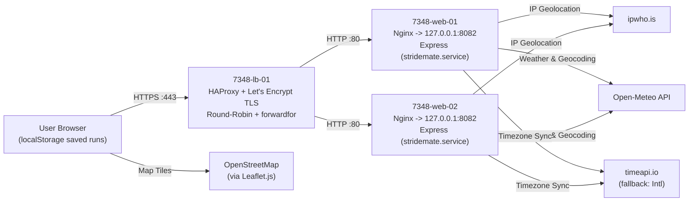
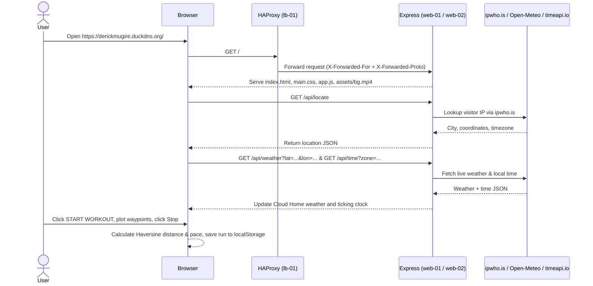

<div align="center">

# StrideMate

StrideMate is a monochrome weather, live time, and workout route-mapping web application built with Node.js, Express, vanilla HTML/CSS/JavaScript, and Leaflet + OpenStreetMap.

**Live on:** [derickmugire.duckdns.org](https://derickmugire.duckdns.org)

</div>

> [!TIP]
> Click **START WORKOUT** on the Cloud Home screen to open the dark OpenStreetMap view, click anywhere on the map to trace a route, and click **Stop** to save the session to **Saved Runs**.

---

## Product preview

<table>
  <tr>
    <td width="42%" valign="top" align="center">
      <strong>Cloud Home (<code>/</code>)</strong><br />
      Frosted-glass cloud card displaying detected city, live weather (click to toggle <code>°C</code> / <code>°F</code>), and live local time over a looping background video (<code>/assets/bg.mp4</code>).
    </td>
    <td width="58%" valign="top" align="center">
      <strong>Workout Map &amp; Saved Runs Drawer</strong><br />
      Full-bleed dark OpenStreetMap centered on the <code>ME</code> marker with click-to-plot route polyline, live <code>TIME</code>, <code>Distance</code>, <code>PACE</code>, <code>Undo</code>, <code>Pause</code> / <code>Resume</code>, <code>Stop</code>, city search, and a slide-over Saved Runs drawer.
    </td>
  </tr>
</table>

---

## Why it is built this way

Most fitness trackers require accounts, cloud databases, and heavy client frameworks just to log a simple run, walk, or ride. StrideMate keeps everything lightweight: the backend fetches live location, weather, and timezone data from public APIs with a 6-second timeout, while completed workouts stay strictly in your browser's `localStorage`.

---

## System architecture



### Request & workout flow



---

## Location & GPS note

> [!IMPORTANT]
> On initial load, StrideMate detects your city from your IP address via `/api/locate` (`X-Forwarded-For` forwarded by HAProxy). When you click **START WORKOUT**, the browser may also ask for GPS permission (`navigator.geolocation`) to center the `ME` marker more precisely:
>
> 1. Click **Allow** if you want the map centered on your exact device coordinates.
> 2. Or use the **Search location...** box on the map screen to jump to any city worldwide.

---

## Interface & controls

StrideMate is organized into two monochrome views and a slide-over drawer:

1. **Cloud Home (`/`)** — Displays detected city, live weather (`°C` / `°F` click-to-toggle), and live local time over `frontend/assets/bg.mp4`, with **START WORKOUT** and the top-right menu button (`≡`).
2. **Workout Map** — Full-bleed dark OpenStreetMap view (`is-dark-map` CSS filter) with **Back**, **Search location...** autocomplete, **Undo** waypoint, and the bottom-right workout card (**TIME**, **Distance**, **PACE**, **Activity** selector for `Run` / `Walk` / `Cycle`, **Pause** / **Resume**, and **Stop**).
3. **Saved Runs Drawer** — Slide-over panel backed by `localStorage` (`stridemate_saved_runs`) with live search, activity filter (`All` / `Run` / `Walk` / `Cycle`), sorting (`Newest` / `Longest Time` / `Longest Distance`), and **Delete**.

---

## Privacy & security model

| Layer | Stored data | Lifecycle |
| :--- | :--- | :--- |
| **Browser (`localStorage`)** | Saved workout summaries (`activity`, `location`, `durationSec`, `distanceKm`, `pace`, `createdAt`) | Stays on your device; deleted individually from Saved Runs |
| **Express backend** | Nothing | Stateless proxy for `/api/*` and static frontend assets |
| **Server disk / database** | Nothing | No database and no persisted user workout history |

Key safeguards:
- **Unexposed backend port:** Express binds strictly to `127.0.0.1:8082` on both web nodes behind Nginx on port `80`, so port `8082` is never reachable publicly.
- **HTTPS everywhere:** `7348-lb-01` redirects `:80` to `:443` (`301`) using a Let's Encrypt certificate for `derickmugire.duckdns.org`.
- **Input validation:** `/api/weather` validates `lat`/`lon` bounds and `/api/time` validates IANA timezone strings before calling upstream APIs.

---

## Local setup

### Prerequisites
- Node.js `18+` (for built-in `fetch`) and `npm`

### 1. Clone and install

```bash
git clone https://github.com/DerrickMugire/Stride.git
cd Stride/backend
npm install
```

### 2. Optional environment variables

No API keys are required. You can optionally override the bind address or port when starting the server:

| Variable | Purpose | Default |
| :--- | :--- | :--- |
| `PORT` | Port Express listens on | `8082` |
| `HOST` | Bind address | `127.0.0.1` |

### 3. Start the server

```bash
npm start
```

Open `http://127.0.0.1:8082`.

---

## API & route reference

| Method | Route | Description |
| :--- | :--- | :--- |
| `GET` | `/` | Serves `frontend/index.html` |
| `GET` | `/api/health` | Returns `{"ok":true,"service":"stridemate","port":8082}` |
| `GET` | `/api/locate` | Detects visitor city, coordinates, and timezone via `ipwho.is` |
| `GET` | `/api/cities?q=...` | Searches matching cities via Open-Meteo Geocoding (min 2 chars) |
| `GET` | `/api/weather?lat=...&lon=...` | Fetches current temperature, WMO weather condition, and wind speed |
| `GET` | `/api/time?zone=...` | Fetches current local time via `timeapi.io` (with `Intl` fallback) |

---

## Project structure

```text
Stride/
├── backend/
│   ├── package.json             # Express manifest
│   └── server.js                # Express static server and /api/* endpoints
├── frontend/
│   ├── assets/
│   │   └── bg.mp4               # Background video used on Cloud Home
│   ├── scripts/
│   │   └── app.js               # Weather/clock state, Leaflet map, workout timer, localStorage runs
│   ├── styles/
│   │   └── main.css             # Monochrome UI theme, dark map filter, Saved Runs drawer
│   └── index.html               # Cloud Home, Workout Map, and Saved Runs markup
├── .gitignore
└── README.md
```

---

## External APIs & credits

StrideMate relies on public, zero-key external APIs and open map data:

| API / Resource | Provider | Purpose in StrideMate | Credit / Docs |
| :--- | :--- | :--- | :--- |
| **Open-Meteo Forecast & Geocoding** | Open-Meteo | Live weather conditions (`GET /api/weather`) and city search (`GET /api/cities`) | [open-meteo.com](https://open-meteo.com/) |
| **ipwho.is** | ipwho.is | Detects initial visitor city, coordinates, and timezone (`GET /api/locate`) | [ipwho.is](https://ipwho.is/) |
| **timeapi.io** | timeapi.io | Syncs local clock to the selected IANA timezone (`GET /api/time`) | [timeapi.io](https://timeapi.io/) |
| **OpenStreetMap & Leaflet** | OpenStreetMap / Leaflet | Interactive map tiles and polyline route rendering | [openstreetmap.org](https://www.openstreetmap.org/) / [leafletjs.com](https://leafletjs.com/) |

Error handling:
- Every upstream request uses a 6-second timeout (`AbortSignal.timeout(6000)`).
- Invalid coordinates or timezone strings return HTTP `400`, while upstream failures return HTTP `502` JSON errors without crashing Express (`timeapi.io` failures fall back cleanly to `Intl.DateTimeFormat`).

---

## Production deployment

The production environment runs across three Ubuntu 20.04 servers:

| Server | Role | Stack |
| :--- | :--- | :--- |
| **`7348-lb-01`** | Load balancer & TLS termination | HAProxy (`:80` -> `:443` 301), Let's Encrypt SSL (`derickmugire.duckdns.org`), `option forwardfor` |
| **`7348-web-01`** | Application node 1 (`35.178.14.237`) | Nginx (`:80` -> `127.0.0.1:8082`) + Node.js 20 (`stridemate.service`) |
| **`7348-web-02`** | Application node 2 (`18.130.237.6`) | Nginx (`:80` -> `127.0.0.1:8082`) + Node.js 20 (`stridemate.service`) |

### 1. Deploy application nodes (`7348-web-01` and `7348-web-02`)

Run the following on **both** web servers:

1. **Install Git, Nginx, and Node.js 20 LTS, then clone and install dependencies:**
   ```bash
   sudo apt update && sudo apt install -y git curl ca-certificates nginx
   curl -fsSL https://deb.nodesource.com/setup_20.x | sudo -E bash -
   sudo apt install -y nodejs
   sudo git clone https://github.com/DerrickMugire/Stride.git /opt/stridemate
   cd /opt/stridemate/backend && npm install --omit=dev
   ```

2. **Run Express as a `systemd` service (`/etc/systemd/system/stridemate.service`):**
   ```ini
   [Unit]
   Description=StrideMate Node.js Server
   After=network.target

   [Service]
   Type=simple
   User=ubuntu
   WorkingDirectory=/opt/stridemate/backend
   Environment=PORT=8082
   Environment=HOST=127.0.0.1
   ExecStart=/usr/bin/node /opt/stridemate/backend/server.js
   Restart=always
   RestartSec=3

   [Install]
   WantedBy=multi-user.target
   ```
   ```bash
   sudo systemctl daemon-reload
   sudo systemctl enable --now stridemate
   ```

3. **Configure Nginx reverse proxy (`/etc/nginx/sites-available/stridemate`):**
   ```nginx
   server {
       listen 80 default_server;
       listen [::]:80 default_server;
       server_name _;

       add_header X-Served-By $hostname always;

       location / {
           proxy_pass http://127.0.0.1:8082;
           proxy_http_version 1.1;
           proxy_set_header Host $host;
           proxy_set_header X-Real-IP $remote_addr;
           proxy_set_header X-Forwarded-For $proxy_add_x_forwarded_for;
           proxy_set_header X-Forwarded-Proto $scheme;
       }
   }
   ```
   ```bash
   sudo rm -f /etc/nginx/sites-enabled/default
   sudo ln -sf /etc/nginx/sites-available/stridemate /etc/nginx/sites-enabled/stridemate
   sudo nginx -t && sudo systemctl reload nginx
   ```

### 2. Configure load balancer (`7348-lb-01`)

1. **Issue the Let's Encrypt SSL certificate and combine it into an HAProxy PEM:**
   ```bash
   sudo systemctl stop haproxy
   sudo certbot certonly --standalone -d derickmugire.duckdns.org --non-interactive --agree-tos -m d.mugire1@alustudent.com
   sudo mkdir -p /etc/haproxy/certs
   sudo sh -c 'cat /etc/letsencrypt/live/derickmugire.duckdns.org/fullchain.pem /etc/letsencrypt/live/derickmugire.duckdns.org/privkey.pem > /etc/haproxy/certs/derickmugire.duckdns.org.pem'
   sudo chmod 600 /etc/haproxy/certs/derickmugire.duckdns.org.pem
   sudo systemctl start haproxy
   ```

2. **Configure `/etc/haproxy/haproxy.cfg`** with TLS termination, HTTP-to-HTTPS redirect, `option forwardfor`, and round-robin balancing:
   ```haproxy
   defaults
       log     global
       mode    http
       option  httplog
       option  dontlognull
       option  forwardfor
       timeout connect 5s
       timeout client  50s
       timeout server  50s

   frontend http_front
       bind *:80
       redirect scheme https code 301 if !{ ssl_fc }

   frontend https_front
       bind *:443 ssl crt /etc/haproxy/certs/derickmugire.duckdns.org.pem
       http-request set-header X-Forwarded-Proto https
       default_backend stridemate_web

   backend stridemate_web
       balance roundrobin
       option httpchk GET /api/health
       http-check expect status 200
       server 7348-web-01 35.178.14.237:80 check
       server 7348-web-02 18.130.237.6:80 check
   ```

3. **Validate and reload HAProxy:**
   ```bash
   sudo haproxy -c -f /etc/haproxy/haproxy.cfg && sudo systemctl reload haproxy
   ```

### 3. Verify load balancing & end-to-end flow

1. **Confirm round-robin distribution across both web servers:**
   ```bash
   curl -sI https://derickmugire.duckdns.org/api/health | grep -iE "HTTP/|x-served-by"
   curl -sI https://derickmugire.duckdns.org/api/health | grep -iE "HTTP/|x-served-by"
   ```
   Observed response headers:
   - First request: `HTTP/1.1 200 OK` with `x-served-by: 7348-web-01`
   - Second request: `HTTP/1.1 200 OK` with `x-served-by: 7348-web-02`

2. **Confirm end-to-end application flows over HTTPS:**
   - `GET /` serves the Cloud Home screen (`200 OK`) and `GET /assets/bg.mp4` streams the background video (`video/mp4`).
   - `/api/locate`, `/api/cities`, `/api/weather`, and `/api/time` return live JSON responses (`200 OK`).

---

## Challenges & how they were solved

| Challenge | Solution |
| :--- | :--- |
| **Load balancer masking visitor IP for geolocation** | Because `7348-lb-01` is hosted in AWS `eu-west-2` (London), `/api/locate` initially saw the load balancer's London IP instead of the user's location. Solved by enabling `option forwardfor` in HAProxy so `X-Forwarded-For` passes the real client IP through Nginx to Express. |
| **HTTPS without a custom `.tech` domain** | Without a `.tech` domain available, a raw load-balancer IP cannot be issued a Let's Encrypt certificate. Solved by pointing `derickmugire.duckdns.org` to `18.132.9.132`, issuing a Let's Encrypt certificate via Certbot, and terminating TLS + `:80 -> :443` redirect in HAProxy. |
| **Keeping application ports unexposed** | Exposing Node.js directly on port `8082` violates server hardening requirements. Solved by binding Express strictly to `127.0.0.1:8082` behind Nginx on `:80` on both web nodes. |
